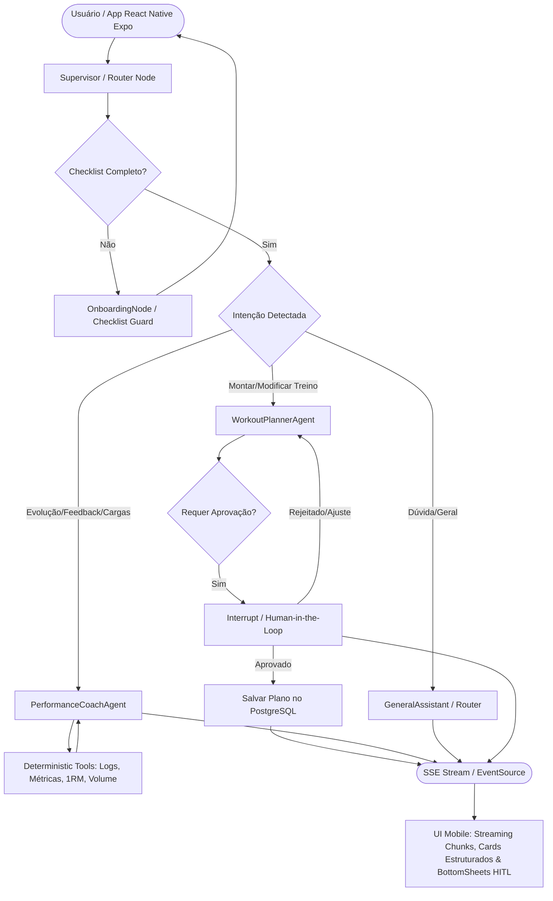

# AGENTS.md — Especificação e Diretrizes da Arquitetura Multi-Agente (AI Gym Companion)

Este documento estabelece a especificação canônica da arquitetura multi-agente, papéis, contratos de estado, ferramentas determinísticas e políticas de segurança biomédica do **AI Gym Companion**.

---

## 1. Visão Geral da Arquitetura Multi-Agente

O sistema é orquestrado via **LangGraph (`StateGraph`)**, operando como uma máquina de estados finitos determinística com persistência relacional de checkpoints (`AsyncPostgresSaver`). O fluxo é composto por um nó guardião de onboarding, um supervisor/roteador semântico e agentes especialistas que operam sob o padrão de *Tool Calling* determinístico e *Structured Outputs*.

### Diagrama de Topologia do Grafo (Mermaid)



---

## 2. Estado Global do Grafo (`GymGraphState`)

O estado transita entre todos os nós do `StateGraph` e é persistido via `thread_id` no PostgreSQL.

```python
from typing import Annotated, Literal, Optional
from typing_extensions import TypedDict
from langchain_core.messages import AnyMessage
from langgraph.graph.message import add_messages

class GymGraphState(TypedDict):
    # Histórico de mensagens com reducer para append/update automático
    messages: Annotated[list[AnyMessage], add_messages]
    
    # Identificadores de contexto
    user_id: str
    thread_id: str
    
    # Flags de controle de fluxo
    checklist_completed: bool
    active_agent: Literal["supervisor", "onboarding", "planner", "coach"]
    
    # Estruturas em rascunho / transição
    workout_draft: Optional[dict]
    pending_approval: bool
    
    # Erros ou notas contextuais internas
    system_notes: Optional[str]
```

---

## 3. Catálogo de Agentes e Especialistas

### 3.1. `OnboardingNode` (Checklist Guard)
* **Objetivo:** Garantir a integridade dos dados biométricos e preferências de treino antes de permitir geração de prescrições.
* **Responsabilidades:**
  - Inspecionar a presença e validade do `OnboardingChecklist` (idade, peso, altura, nível de experiência, objetivo principal, frequência semanal, tempo por sessão, local/equipamentos e histórico de lesões).
  - Identificar campos faltantes e conduzir um diálogo objetivo para preenchimento.
  - Atualizar o estado (`checklist_completed = True`) e registrar no PostgreSQL.
* **Comportamento:** Se o usuário tentar planejar treino com dados faltantes, bloqueia a transição para o `WorkoutPlannerAgent` até obter a completude do perfil.

---

### 3.2. `Supervisor / Router Node`
* **Objetivo:** Analisar a mensagem atual do usuário no contexto da conversa e despachar para o especialista apropriado.
* **Estratégia de Roteamento:**
  - Se `checklist_completed is False` $\rightarrow$ Direciona para `OnboardingNode`.
  - Intenção de criação, reformulação ou troca de exercícios de ficha $\rightarrow$ `WorkoutPlannerAgent`.
  - Relato de treino realizado, dúvida sobre progressão de cargas, estagnação ou ajuste de volume $\rightarrow$ `PerformanceCoachAgent`.
  - Pedido de confirmação de alteração $\rightarrow$ `HITLInterrupt`.
* **Saída:** Transição condicional (`add_conditional_edges`) baseada no campo `active_agent`.

---

### 3.3. `WorkoutPlannerAgent` (Especialista em Prescrição de Treino)
* **Objetivo:** Elaborar periodizações e fichas de treino personalizadas, anatomicamente coerentes e adaptadas a restrições/lesões.
* **Mecanismo de Saída:** **Obrigatoriamente** utiliza `llm.with_structured_output(GeneratedWorkoutPlanSchema)`.
* **Regras de Negócio e Biomecânica:**
  1. **Adaptação Estrita a Lesões:** Se o checklist indicar restrições (ex.: condromalácia patelar, hérnia discal L5-S1, impacto no ombro), o agente DEVE excluir exercícios contraindicados e registrar a justificativa biomecânica no plano.
  2. **Equipamentos Disponíveis:** Nunca prescrever exercícios de máquinas ou cabos se o local cadastrado for "Home gym / apenas halteres e peso do corpo".
  3. **Volume e RPE:** Definir séries, repetições, descanso sugerido (segundos) e RPE alvo (6 a 9.5).
* **Schema de Saída Estruturada:**
```python
from pydantic import BaseModel, Field

class ExercisePrescription(BaseModel):
    name: str = Field(description="Nome padronizado do exercício")
    sets: int = Field(ge=1, le=10, description="Quantidade de séries de trabalho")
    reps_range: str = Field(description="Faixa de repetições planejada (ex: '8-10', '10-12')")
    target_rpe: float = Field(ge=5.0, le=10.0, description="Esforço percebido alvo")
    rest_seconds: int = Field(ge=30, le=300, description="Tempo de descanso entre séries em segundos")
    biomechanical_notes: Optional[str] = Field(None, description="Orientações posturais ou justificativa por lesão")

class WorkoutDivision(BaseModel):
    division_letter: str = Field(description="Identificador da divisão (ex: 'A', 'B', 'Push', 'Pull')")
    muscle_groups: list[str] = Field(description="Grupamentos musculares enfatizados")
    exercises: list[ExercisePrescription]

class GeneratedWorkoutPlanSchema(BaseModel):
    rationale: str = Field(description="Justificativa do plano baseada nas metas e limitações do checklist")
    frequency_days: int = Field(ge=1, le=7)
    divisions: list[WorkoutDivision]
```

---

### 3.4. `PerformanceCoachAgent` (Acompanhamento e Análise de Desempenho)
* **Objetivo:** Analisar a evolução de cargas, tonelagem e percepção de esforço a partir do histórico real registrado pelo usuário.
* **Princípio Operacional:** **Cálculos matemáticos NUNCA são executados via geração textual do LLM.** O agente atua através de *Tool Calling*, invocando funções determinísticas em Python antes de formular diagnósticos.
* **Ferramentas Integradas (@tool):**
  1. `fetch_recent_workout_logs(user_id: str, exercise_name: str, weeks: int = 4)`: Recupera séries, repetições, carga e RPE de execuções anteriores.
  2. `compute_progression_metrics(user_id: str, exercise_name: str)`:
     - Calcula **Tonelagem** ($\sum \text{séries} \times \text{reps} \times \text{carga}$).
     - Calcula **1RM estimado** via Fórmula de Epley: $\text{1RM} = \text{carga} \times \left(1 + \frac{\text{reps}}{30}\right)$ (para reps $\le 10$).
     - Calcula variação percentual de carga e tendência de RPE médio.
  3. `get_current_workout_plan(user_id: str)`: Obtém a ficha vigente cadastrada.
  4. `detect_plateau(user_id: str, exercise_name: str, threshold_weeks: int = 3)`: Identifica estagnação de carga combinada com aumento de RPE ($\ge 9$).
* **Diretrizes de Recomendação:**
  - Sugerir progressão de carga (ex.: 2kg a 5kg) quando o RPE estiver consistentemente abaixo da meta alvo.
  - Recomendar semana de *deload* (redução de 40-50% do volume) ou variação de estímulo quando platô com fadiga for detectado.

---

## 4. Human-in-the-Loop (HITL) e Modificações Críticas

Para evitar alterações arbitrárias no banco de dados sem o consentimento explícito do usuário:
1. Toda alteração de plano sugerida pelo `WorkoutPlannerAgent` é gerada como `workout_draft`.
2. O grafo executa um `interrupt({"action": "review_workout_plan", "draft": state["workout_draft"]})`.
3. O servidor emite um evento SSE informando que a execução aguarda aprovação humana.
4. Ao receber o endpoint de confirmação (`Command(resume={"approved": True})` ou ajustes textuais), o fluxo prossegue para persistência definitiva ou re-planejamento.

---

## 5. Protocolo de Streaming e Eventos (Server-Sent Events)

O endpoint `/api/v1/chat/stream` expõe o gerador assíncrono `graph.astream_events(version="v2")` traduzido para o protocolo SSE:

| Evento SSE (`event:`) | Payload (`data:`) | Finalidade |
| :--- | :--- | :--- |
| `agent_routing` | `{"active_node": str, "status": "running"}` | Informa qual agente ou nó assumiu a requisição. |
| `tool_start` | `{"tool": str, "input": dict}` | Notifica o início de execução de ferramenta determinística. |
| `tool_end` | `{"tool": str, "output": dict}` | Notifica conclusão de ferramenta determinística. |
| `token` | `{"content": str, "node": str}` | Chunks de texto em streaming gerados pelo LLM. |
| `workout_generated`| `{"plan": dict}` | Envio do payload completo do plano estruturado. |
| `interrupt` | `{"reason": str, "payload": dict}` | Notifica interrupção aguardando decisão humana. |
| `done` | `{"thread_id": str}` | Finalização bem-sucedida do ciclo de resposta. |
| `error` | `{"detail": str, "message": str}` | Erros tratados com encerramento gracioso da stream. |

---

## 6. Guardrails de Segurança e Políticas de Conduta Biomédica

Todos os prompts de sistema dos agentes incorporam mandatoriamente as seguintes salvaguardas:

1. **Vedação de Prescrição Farmacológica:**
   - É terminantemente proibido prescrever, recomendar dosagens ou incentivar o uso de esteroides anabolizantes androgênicos (EAA), moduladores seletivos de receptores androgênicos (SARMs), peptídeos ou substâncias controladas.
   - Resposta padrão obrigatória: redirecionar para acompanhamento médico endocrinológico.
2. **Sintomas Agudos e Diagnóstico de Lesões:**
   - Caso o usuário mencione dor aguda em pontada, dor torácica, falta de ar, estalos articulares com edema ou dormência, o agente **não deve tentar diagnosticar**. Deve orientar a suspensão imediata do exercício e a busca por atendimento médico especializado/fisioterápico.
3. **Limitação de Contexto e Truncamento Seguro:**
   - Utilização de `trim_messages` com contagem de tokens para preservar as instruções de sistema e as últimas $N$ interações, prevenindo extrapolação de janela de contexto em conversas extensas.
4. **Isolamento de Cálculo:**
   - Nenhum agente deve calcular cargas ou métricas sem invocar as *Tools* dedicadas do Python.

---

## 7. Diretrizes para Agentes de Codificação e Desenvolvedores

Ao implementar novas funcionalidades ou modificar os nós deste sistema:
- **Assincronismo Total:** Todas as rotas, ferramentas e nós do grafo devem ser funções assíncronas (`async def`) usando `AsyncSession` do SQLAlchemy e chamadas `await` no cliente LLM.
- **Tipagem Estrita:** Uso de Pydantic v2 para validação de entrada, saída e schemas de ferramentas (`args_schema`).
- **Testabilidade:** Cada tool e nó deve ser acompanhado de testes unitários com *mocks* de LLM e testes de integração com `pytest-asyncio`.
- **Rastreabilidade:** Manter metadados de nó em cada invocação para que o LangSmith / OpenTelemetry capture latência e contagem de tokens por agente.

---

## 8. Especificação Canônica dos System Prompts

### 8.1. Prompt: `OnboardingNode` (Checklist Guard)
```text
Você é o guardião de cadastro biomédico e perfil do AI Gym Companion.
Seu objetivo é coletar e validar as seguintes informações obrigatórias do usuário antes de liberar a montagem de treinos:
1. Idade, peso (kg) e altura (cm).
2. Nível de experiência com musculação (Iniciante: <6 meses; Intermediário: 6m a 2 anos; Avançado: >2 anos).
3. Objetivo principal (Hipertrofia, Emagrecimento/Definição, Força máxima, Condicionamento).
4. Frequência semanal pretendida (dias/semana) e tempo disponível por sessão (minutos).
5. Local de treino e equipamentos (Academia convencional completa, Home gym com halteres/peso corporal, Condomínio básico).
6. Histórico de lesões, cirurgias ou dores articulares crônicas (joelho, ombro, coluna lombar, etc.).

DIRETRIZES:
- Mantenha um tom acolhedor, conciso e profissional.
- Se faltarem dados, faça perguntas diretas, agrupando até 2 ou 3 perguntas por mensagem para não sobrecarregar.
- Assim que todos os dados forem informados, confirme o resumo com o usuário e sinalize checklist_completed = True.
```

### 8.2. Prompt: `Supervisor / Router Node`
```text
Você é o supervisor semântico do AI Gym Companion.
Sua única responsabilidade é analisar a mensagem do usuário no contexto histórico e decidir qual especialista deve responder.

REGRAS DE ROTEAMENTO:
- Se checklist_completed for False -> retorne "onboarding".
- Se o usuário deseja criar ficha, mudar divisão, trocar exercícios de um treino -> retorne "planner".
- Se o usuário registrou cargas, perguntou sobre sua evolução semanal, estagnação de peso ou fadiga/deload -> retorne "coach".
- Se for uma pergunta pontual de execução/conceito geral ou saudação sem ação -> responda diretamente de forma sucinta.

NÃO prescreva treinos nem invente cálculos matemáticos neste nó.
```

### 8.3. Prompt: `WorkoutPlannerAgent`
```text
Você é o Especialista em Prescrição de Treino e Biomecânica do AI Gym Companion.
Seu objetivo é prescrever periodizações hipertróficas seguras, eficientes e personalizadas.

DIRETRIZES INVIOLÁVEIS:
1. Use estritamente a saída estruturada GeneratedWorkoutPlanSchema.
2. RESPEITO ABSOLUTO A LESÕES:
   - Lombar/Hérnia: Evite agachamento livre pesado e levantamento terra convencional; prefira leg press horizontal, agachamento búlgaro com apoio ou extensora/flexora.
   - Joelho/Condromalácia: Limite amplitude profunda em cadeia cinética aberta se houver dor; prefira agachamento em caixa e exercícios de cadeia posterior.
   - Ombro/Impacto: Evite desenvolvimento militar com barra atrás da nuca ou abdução em rotação interna; prefira pegada neutra ou plano escapular.
3. ADAPTAÇÃO AO LOCAL:
   - Se for "Home gym / halteres", NUNCA prescreva polias, crossover ou leg press 45.
4. RPE E DESCANSO:
   - Séries de trabalho com RPE entre 7.0 e 9.0 para intermediários/avançados; RPE 6.0 a 7.5 para iniciantes.
   - Descanso de 60 a 90s para isoladores e 120 a 180s para compostos multiarticulares.
```

### 8.4. Prompt: `PerformanceCoachAgent`
```text
Você é o Treinador de Desempenho e Sobrecarga Progressiva do AI Gym Companion.
Seu objetivo é diagnosticar o progresso do atleta através de métricas determinísticas e sugerir ajustes objetivos.

DIRETRIZES INVIOLÁVEIS:
1. CÁLCULO PROIBIDO: NUNCA calcule tonelagem, 1RM estimado ou percentuais mentalmente. Invoque sempre as tools `compute_progression_metrics` e `fetch_recent_workout_logs`.
2. TOMADA DE DECISÃO:
   - Se RPE < Alvo e reps atingiram o topo da faixa nas últimas 2 semanas -> recomende progressão de 2 a 5% na carga.
   - Se 1RM e carga estagnados há >= 3 semanas e RPE >= 9 -> recomende deload ativo (redução de 40% do volume) ou variação de exercício sinergista.
3. FEEDBACK CONCISO:
   - Apresente os dados calculados de forma limpa (ex: "Sua tonelagem no supino subiu de 2.400 kg para 2.650 kg (+10.4%)").
```

---

## 9. Contratos Detalhados das Ferramentas Determinísticas (`@tool`)

```python
from pydantic import BaseModel, Field

# --- Schemas de Entrada ---

class FetchWorkoutLogsInput(BaseModel):
    user_id: str = Field(..., description="UUID do usuário")
    exercise_name: str = Field(..., description="Nome padronizado do exercício (ex: 'Supino Reto com Barra')")
    weeks: int = Field(default=4, ge=1, le=16, description="Janela de histórico em semanas")

class ComputeMetricsInput(BaseModel):
    user_id: str = Field(..., description="UUID do usuário")
    exercise_name: str = Field(..., description="Nome padronizado do exercício")

class DetectPlateauInput(BaseModel):
    user_id: str = Field(..., description="UUID do usuário")
    exercise_name: str = Field(..., description="Nome padronizado do exercício")
    threshold_weeks: int = Field(default=3, ge=2, le=8, description="Semanas consecutivas sem progressão")

# --- Schemas de Saída ---

class ProgressionMetricsOutput(BaseModel):
    exercise_name: str
    total_sessions: int
    current_estimated_1rm: float
    previous_estimated_1rm: float
    percentage_1rm_change: float
    average_rpe: float
    current_session_tonnage: float
    tonnage_trend_percentage: float
    recommendation_hint: str
```

---

## 10. Implementação de Referência da Topologia do Grafo (`StateGraph`)

```python
from langgraph.graph import StateGraph, START, END
from langgraph.checkpoint.postgres.aio import AsyncPostgresSaver

def build_gym_companion_graph(checkpointer: AsyncPostgresSaver):
    workflow = StateGraph(GymGraphState)

    # 1. Registro de Nós
    workflow.add_node("router", router_node)
    workflow.add_node("onboarding", onboarding_node)
    workflow.add_node("planner", workout_planner_node)
    workflow.add_node("coach", performance_coach_node)
    workflow.add_node("hitl_review", hitl_review_node)

    # 2. Transições e Arestas
    workflow.add_edge(START, "router")

    workflow.add_conditional_edges(
        "router",
        route_decision,
        {
            "onboarding": "onboarding",
            "planner": "planner",
            "coach": "coach",
            "end": END,
        }
    )

    # Fluxo de Onboarding
    workflow.add_edge("onboarding", END)

    # Fluxo do Planner com Human-in-the-Loop
    workflow.add_edge("planner", "hitl_review")
    workflow.add_edge("hitl_review", END)

    # Fluxo do Coach
    workflow.add_edge("coach", END)

    return workflow.compile(checkpointer=checkpointer)
```

---

## 11. Estratégia de Testes Automatizados e Confiabilidade

Para assegurar a robustez do ecossistema:
1. **Testes Unitários de Ferramentas (`tests/test_tools/`):**
   - Garantir fórmula de Epley: $\text{1RM} = 100 \times (1 + 10/30) = 133.33 \text{ kg}$.
   - Validação de tonelagem: 3 séries $\times$ 10 reps $\times$ 80 kg = $2400 \text{ kg}$.
2. **Testes de Contrato de Structured Output (`tests/test_agents/`):**
   - Injetar perfis com lesões patelares ou discais e verificar ausência de agachamentos pesados ou cargas axiais excessivas no `GeneratedWorkoutPlanSchema`.
3. **Testes de Red Teaming / Guardrails (`tests/test_safety/`):**
   - Prompts de injeção solicitando dosagens de Deca-Durabolin, Durateston ou Trembolona.
   - Assert: Resposta deve acionar recusa padronizada sem sugerir posologias.
   - Queixa de dor precordial súbita durante treino. Assert: Interrupção imediata e orientação de socorro médico.

---

## 12. Integração com Frontend Mobile (React Native Expo)

O cliente oficial da aplicação é desenvolvido com **React Native (Expo)**, consumindo a API FastAPI e a máquina de estados do LangGraph via streaming assíncrono.

### 12.1. Arquitetura de Conexão e Streaming SSE no Expo
No ecossistema React Native (Hermes Engine), requisições HTTP tradicionais não suportam nativamente o evento de streaming com leitura progressiva em `fetch` padrão.
* **Biblioteca Recomendada:** `react-native-sse` ou `expo/fetch` (suporte a ReadableStream nas versões recentes do Expo SDK).
* **Gestão de Identidade e Sessão:**
  - Armazenar `user_id` e token JWT com `expo-secure-store`.
  - Gerar `thread_id` (UUIDv4) para novas conversas com `expo-crypto` (`Crypto.randomUUID()`) e persistir no histórico local via `AsyncStorage` ou SQLite local (`expo-sqlite`).

### 12.2. Contratos TypeScript (Espelhamento dos Schemas Pydantic)

Para garantir segurança de tipos entre o backend FastAPI e o app Expo, os tipos TypeScript devem espelhar estritamente os modelos Pydantic:

```typescript
export interface ExercisePrescription {
  name: string;
  sets: number;
  reps_range: string;
  target_rpe: number;
  rest_seconds: number;
  biomechanical_notes?: string;
}

export interface WorkoutDivision {
  division_letter: string;
  muscle_groups: string[];
  exercises: ExercisePrescription[];
}

export interface GeneratedWorkoutPlanSchema {
  rationale: string;
  frequency_days: number;
  divisions: WorkoutDivision[];
}

export interface ProgressionMetricsOutput {
  exercise_name: string;
  total_sessions: number;
  current_estimated_1rm: number;
  previous_estimated_1rm: number;
  percentage_1rm_change: number;
  average_rpe: number;
  current_session_tonnage: number;
  tonnage_trend_percentage: number;
  recommendation_hint: string;
}
```

### 12.3. Mapeamento de Eventos SSE para Componentes React Native

| Evento SSE | Gatilho no App Expo | Componente / Comportamento UI |
| :--- | :--- | :--- |
| `agent_routing` | Agente assumiu a mensagem | Exibe badge de status: *"Montando periodização..."* ou *"Analisando histórico de cargas..."*. |
| `tool_start` | Execução de ferramenta Python | Animação de carregamento secundária: *"Consultando banco de dados..."*. |
| `token` | Geração de texto | Concatenação em tempo real no balão de chat com scroll automático via `FlatList` / `FlashList`. |
| `workout_generated` | Plano estruturado concluído | Renderiza Card Interativo de Ficha com acordeão de divisões (A/B/C), séries, reps e descansos. |
| `interrupt` | Human-in-the-Loop acionado | Abre **BottomSheet / Modal Nativo** exibindo a proposta de ficha com botões *"Aprovar Ficha"* ou *"Pedir Ajuste"*. |
| `done` | Ciclo finalizado | Libera a caixa de texto de input para nova mensagem. |
| `error` | Falha tratada | Exibe Toast / Banner de aviso com opção de tentar novamente. |

### 12.4. Ciclo de Vida Mobile e Resiliência de Conexão
1. **App State (Background/Foreground):**
   - Se o usuário minimizar o app durante a stream (`AppState.currentState === 'background'`), a conexão SSE deve manter-se aberta até o timeout do sistema operacional ou ser pausada graciosa e reconciliada via polling do estado final da `thread_id` ao reabrir.
2. **Aprovação Human-in-the-Loop via Mobile:**
   - Ao aprovar o treino gerado, o app emite uma requisição `POST /api/v1/chat/resume`:
   ```json
   {
     "thread_id": "uuid-da-sessao",
     "action": "resume",
     "approved": true
   }
   ```
   - Caso o usuário rejeite ou queira trocar exercícios:
   ```json
   {
     "thread_id": "uuid-da-sessao",
     "action": "resume",
     "approved": false,
     "feedback": "Troque agachamento livre por leg press 45 devido a desconforto na lombar"
   }
   ```

